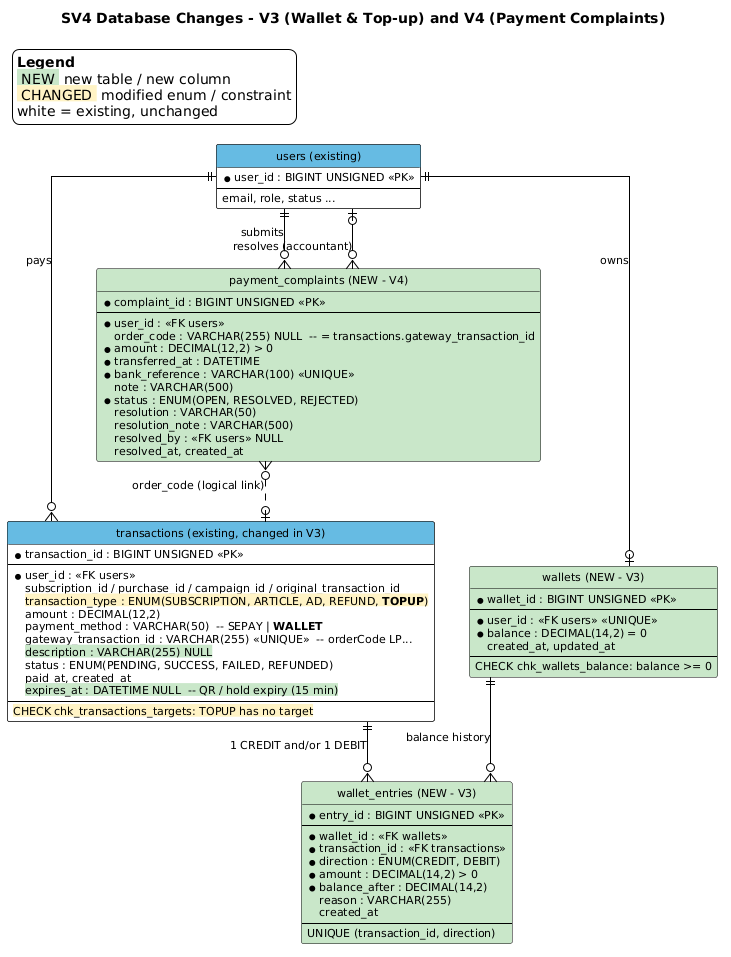

# THAY ĐỔI CƠ SỞ DỮ LIỆU — SV4 (Kế toán, Thanh toán & Đối soát)

> **Bản tiếng Việt của sơ đồ ER:** `diagrams_vi/erd_sv4_db_changes_vi.png`.

> Áp dụng tự động bằng Flyway khi backend khởi động (profile `dev`). Đã chạy thành công trên MySQL 8.0 ngày 20/10/2026:
> `V3 wallet and topup` (18:54) và `V4 payment complaints` (19:00).
> Không sửa file migration cũ (V1, V2). Mọi thay đổi nằm trong 2 file mới.



Màu trên sơ đồ: **xanh lá** = bảng/cột mới, **vàng** = enum/ràng buộc bị sửa, **trắng** = bảng cũ không đổi.

---

## 1. Tóm tắt

| Migration | File | Thay đổi | Lý do |
|---|---|---|---|
| V3 | `backend/src/main/resources/db/migration/V3__wallet_and_topup.sql` | Sửa bảng `transactions`; thêm bảng `wallets`, `wallet_entries` | Ví LocalPress: nạp tiền qua QR SePay, trả đơn bằng số dư, nhận tiền chuyển thiếu/thừa/về muộn |
| V4 | `backend/src/main/resources/db/migration/V4__payment_complaints.sql` | Thêm bảng `payment_complaints` | Thay "duyệt chuyển khoản thủ công" bằng luồng khiếu nại (UC051) |

Không xóa bảng, không xóa cột, không đổi kiểu dữ liệu cột cũ, nên dữ liệu cũ giữ nguyên.

---

## 2. V3 — Bảng `transactions` (sửa)

| Thay đổi | Trước | Sau | Ghi chú |
|---|---|---|---|
| `transaction_type` | `ENUM('SUBSCRIPTION','ARTICLE','AD','REFUND')` | thêm `'TOPUP'` | Đơn nạp ví |
| Cột mới `description` | — | `VARCHAR(255) NULL` | Tên bài / gói / chiến dịch hiển thị trên trang thanh toán |
| Cột mới `expires_at` | — | `DATETIME NULL` | Hạn mã QR / giữ chỗ = `created_at + 15 phút`. Webhook về sau mốc này với đơn quảng cáo là "tiền về muộn" (Rule 6) |
| CHECK `chk_transactions_targets` | 4 nhánh (mỗi loại gắn đúng 1 đối tượng) | thêm nhánh `TOPUP`: cả 4 cột đối tượng đều `NULL` | Đơn nạp ví không gắn bài, gói hay chiến dịch nào |
| `payment_method` | `VARCHAR(50)` (không đổi kiểu) | giá trị dùng thực tế: `SEPAY`, `WALLET` | Backend luôn ghi `SEPAY` khi tạo đơn, đổi thành `WALLET` khi trả bằng ví. Không còn `BANK_TRANSFER` |

Cách V3 sửa CHECK: `ALTER TABLE transactions DROP CHECK chk_transactions_targets;` rồi `ADD CONSTRAINT` lại với 5 nhánh.

**Quy ước mã đơn** (`gateway_transaction_id`, UNIQUE): `LP` + `yyMMddHHmm` + 4 ký tự, ví dụ `LP2610201936E97D`. Các khoản tiền không gắn được vào đơn tạo một giao dịch `TOPUP` con với mã có hậu tố:

| Mã | Khi nào |
|---|---|
| `{orderCode}-LATE` | Booking quảng cáo trả sau khi hết hạn giữ chỗ, hoặc đơn đã FAILED/REFUNDED |
| `{orderCode}-PART-{mãGD}` | Chuyển thiếu |
| `{orderCode}-EXCESS` | Phần chuyển thừa |
| `CMP-{mãGD}` | Kế toán cộng ví từ khiếu nại |

Vì `gateway_transaction_id` là UNIQUE, webhook gửi lại không tạo được bản ghi con thứ 2 (Rule 5).

## 3. V3 — Bảng mới `wallets`

| Cột | Kiểu | Ràng buộc | Ý nghĩa |
|---|---|---|---|
| `wallet_id` | BIGINT UNSIGNED | PK, AUTO_INCREMENT | |
| `user_id` | BIGINT UNSIGNED | NOT NULL, **UNIQUE**, FK → `users` | Mỗi user tối đa 1 ví, tạo tự động lần đầu được cộng/trừ |
| `balance` | DECIMAL(14,2) | NOT NULL, mặc định 0, **CHECK `balance >= 0`** | Số dư không bao giờ âm, kể cả khi code lỗi |
| `created_at`, `updated_at` | DATETIME | | |

## 4. V3 — Bảng mới `wallet_entries`

| Cột | Kiểu | Ràng buộc | Ý nghĩa |
|---|---|---|---|
| `entry_id` | BIGINT UNSIGNED | PK | |
| `wallet_id` | BIGINT UNSIGNED | FK → `wallets` | |
| `transaction_id` | BIGINT UNSIGNED | FK → `transactions` | Giao dịch sinh ra biến động |
| `direction` | ENUM('CREDIT','DEBIT') | | Cộng / trừ |
| `amount` | DECIMAL(14,2) | CHECK `amount > 0` | |
| `balance_after` | DECIMAL(14,2) | | Số dư sau biến động (đối chiếu nhanh) |
| `reason` | VARCHAR(255) | | Hiện trên trang `/wallet` |
| `created_at` | DATETIME | INDEX (`wallet_id`, `created_at`) | |
| — | — | **UNIQUE (`transaction_id`, `direction`)** | Một giao dịch chỉ cộng 1 lần và trừ 1 lần, chốt chặn cuối ở tầng DB |

Bất biến đã kiểm trong test E2E: `wallets.balance = SUM(CREDIT) - SUM(DEBIT)` của `wallet_entries`.

## 5. V4 — Bảng mới `payment_complaints`

| Cột | Kiểu | Ràng buộc | Ý nghĩa |
|---|---|---|---|
| `complaint_id` | BIGINT UNSIGNED | PK | |
| `user_id` | BIGINT UNSIGNED | FK → `users` | Khách gửi khiếu nại |
| `order_code` | VARCHAR(255) NULL | | Mã đơn khách khai (không bắt buộc); phải là đơn của chính khách, nếu không thì 403 |
| `amount` | DECIMAL(12,2) | CHECK `> 0` | Số tiền khách nói đã chuyển |
| `transferred_at` | DATETIME | | Thời gian chuyển |
| `bank_reference` | VARCHAR(100) | **UNIQUE** | Mã giao dịch trên biên lai; 1 lần chuyển chỉ khiếu nại 1 lần (trùng thì 409) |
| `note` | VARCHAR(500) | | |
| `status` | ENUM('OPEN','RESOLVED','REJECTED') | INDEX (`status`, `created_at`) | |
| `resolution` | VARCHAR(50) | | Kết quả khi ghi nhận: `SUCCESS`, `UNDERPAID_CREDITED_TO_WALLET`, `LATE_PAYMENT_CREDITED_TO_WALLET`, `CREDITED_WALLET`... |
| `resolution_note` | VARCHAR(500) | | Ghi chú / **lý do từ chối (bắt buộc khi REJECTED)**, khách nhìn thấy |
| `resolved_by` | BIGINT UNSIGNED NULL | FK → `users` (ON DELETE SET NULL) | Kế toán xử lý |
| `resolved_at`, `created_at` | DATETIME | | |

`order_code` chỉ là liên kết logic tới `transactions.gateway_transaction_id`, không đặt FK. Lý do: khách có thể khai sai mã, khi đó kế toán vẫn xử lý được bằng cách cộng vào ví.

## 5b. V5 — Bảng mới `sepay_webhook_logs` (21/10/2026)

File: `V5__sepay_webhook_logs.sql`. Mỗi khoản tiền SePay báo về (webhook), mỗi giao dịch kéo về qua API SePay, và mỗi lần bấm nút giả lập đều ghi 1 dòng.

| Cột | Kiểu | Ý nghĩa |
|---|---|---|
| `log_id` | BIGINT PK | |
| `source` | ENUM('WEBHOOK','API_SYNC','SIMULATION') | SePay gọi vào / LocalPress hỏi API SePay / nút demo |
| `sepay_id` | BIGINT, **UNIQUE** | Id giao dịch phía SePay. Chống xử lý trùng khi SePay gửi lại (tối đa 7 lần) hoặc vừa nhận webhook vừa đồng bộ API. Null với bản giả lập, bản sai khóa, bản lỗi |
| `auth_ok` | BOOLEAN | Khóa webhook có đúng không (sai thì vẫn ghi để kiểm toán, không xử lý) |
| `gateway`, `account_number`, `transfer_type`, `transfer_amount`, `content`, `payment_code`, `reference_code`, `transaction_date` | | Các trường SePay gửi |
| `order_code` | VARCHAR | Mã đơn LP... tìm được trong nội dung chuyển khoản |
| `result_status`, `result_message` | VARCHAR | SUCCESS, ALREADY_PROCESSED, DUPLICATE_DELIVERY, ORDER_NOT_FOUND, UNDERPAID_CREDITED_TO_WALLET, LATE_PAYMENT_CREDITED_TO_WALLET, IGNORED_OUTGOING, INVALID_SIGNATURE, ERROR |
| `raw_payload` | TEXT | Nguyên văn JSON nhận được |
| `remote_ip`, `received_at` | | IP gọi vào (qua tunnel lấy `X-Forwarded-For`), thời điểm nhận |

Index: `received_at`, `order_code`, (`result_status`, `received_at`). Không có khóa ngoại tới `transactions`: log phải ghi được cả khi không tìm thấy đơn.

## 6. Ảnh hưởng tới truy vấn báo cáo

| Chỗ | Thay đổi | Lý do |
|---|---|---|
| `TransactionRepository.calculateTotalGrossRevenue` | loại `TOPUP` khỏi doanh thu | Tiền nạp là nợ phải trả khách, chỉ thành doanh thu khi khách tiêu (Rule 16) |
| `FinanceReconciliationService` (tổng tiền đối chiếu sao kê) | `status='SUCCESS' AND type<>'REFUND' AND payment_method<>'WALLET'` | Tiền vào ngân hàng gồm cả tiền nạp; đơn trả bằng ví không có tiền mới vào ngân hàng |
| `FinanceReportController` alerts | bỏ `MANUAL_TRANSFER_WAITING`, thêm `COMPLAINT_OPEN` | Không còn duyệt chuyển khoản thủ công |

## 7. Bảng của module khác

Không sửa bảng của SV1/SV3/SV5. `transactions` vẫn yêu cầu `purchase_id` / `subscription_id` / `campaign_id` là id **bản ghi thật**, do module nguồn (SV3, SV1) tạo trước khi gọi `POST /api/v1/finance/orders`.

## 8. Kiểm tra nhanh trên máy

```sql
SELECT version, description, success FROM flyway_schema_history ORDER BY installed_rank;
SHOW CREATE TABLE wallets;
SHOW CREATE TABLE wallet_entries;
SHOW CREATE TABLE payment_complaints;
SHOW CREATE TABLE sepay_webhook_logs;
SELECT source, result_status, COUNT(*) FROM sepay_webhook_logs GROUP BY source, result_status;
SELECT w.user_id, w.balance,
       (SELECT SUM(IF(direction='CREDIT', amount, -amount)) FROM wallet_entries e WHERE e.wallet_id = w.wallet_id) AS by_entries
FROM wallets w;
```
