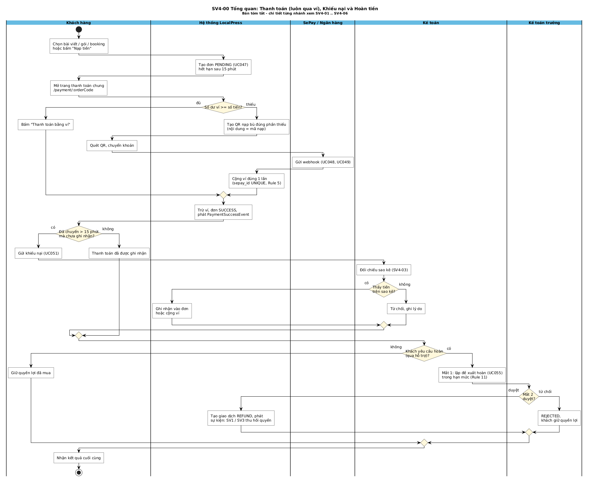
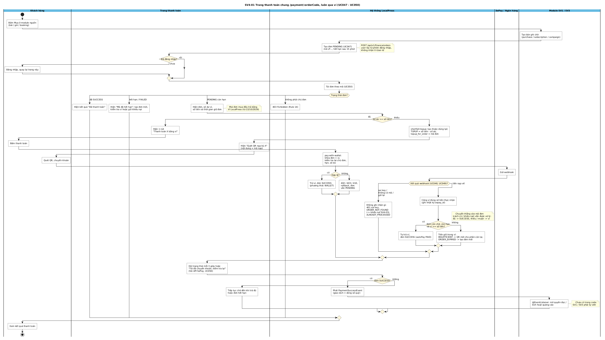
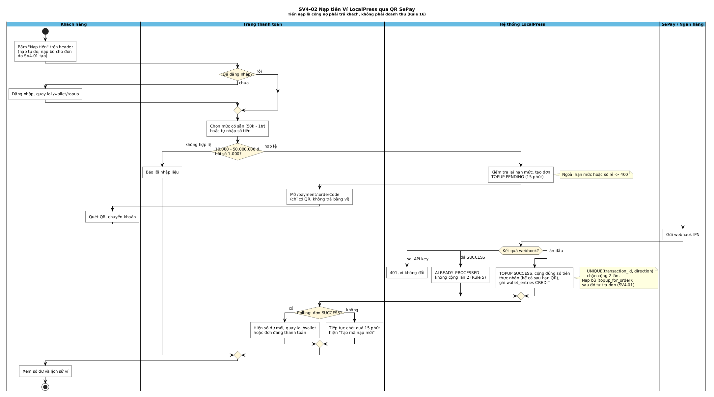
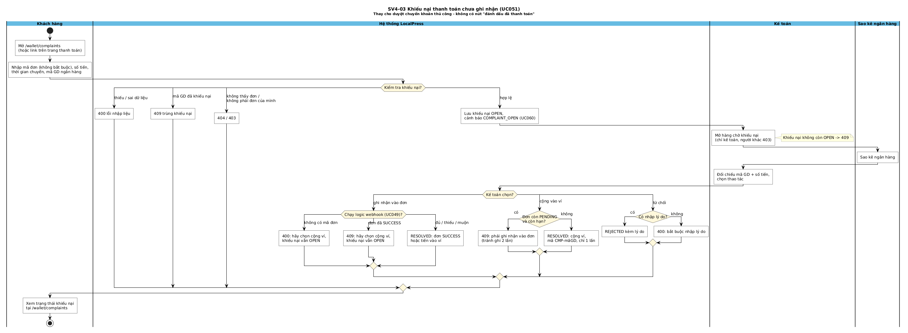
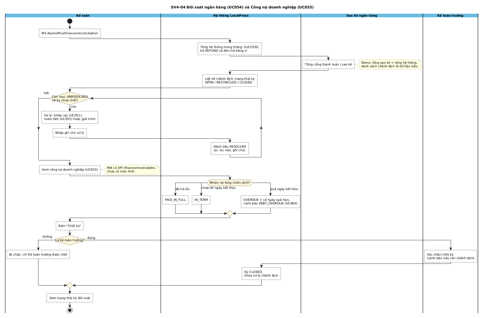
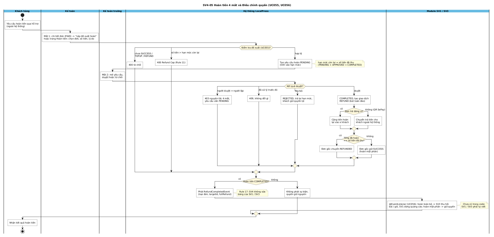
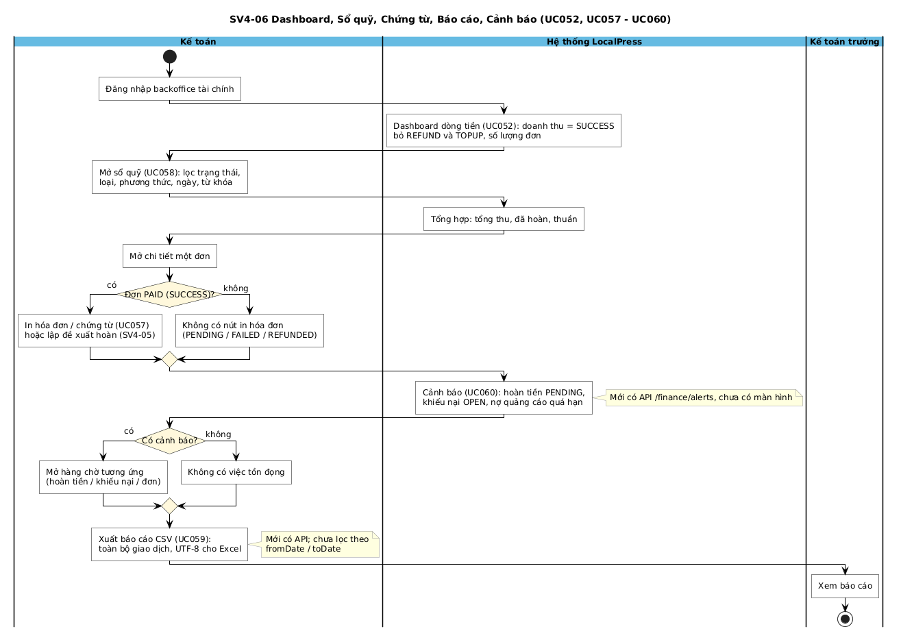

# SWIMLANE SV4 — Kế toán, Thanh toán & Đối soát

> 7 sơ đồ, mỗi sơ đồ có bản tiếng Anh (`diagrams/`) và bản tiếng Việt (`diagrams_vi/`) cùng bố cục, cùng bản chỉnh tay `drawio/`.
> Mọi nhánh đã được **đối chiếu với code thật** (`backend/.../finance`, `frontend/src/features/finance`), lần rà soát gần nhất 21/10/2026.
> Nguồn: `03_tools/gen_puml.py` (1 định nghĩa song ngữ sinh ra cả 14 file `.puml`) → `render_puml.py` ra PNG; `gen_drawio.py` ra `.drawio`.

**Quy ước ký hiệu (chuẩn UML Activity):**
- Mỗi lane là một bên tham gia: Khách hàng, Trang thanh toán, Hệ thống LocalPress, SePay / Ngân hàng, Kế toán, Kế toán trưởng, Sao kê ngân hàng, Module SV1 / SV3.
- Chấm đen = bắt đầu; chấm đen có viền = **kết thúc, mỗi sơ đồ đúng 1 điểm**. Nhánh lỗi không dừng giữa chừng mà ghi kết quả rồi dồn về bước cuối.
- Hộp chữ nhật = hành động. Hình thoi / lục giác có câu hỏi = điểm quyết định (chỉ đi đúng 1 nhánh). Hình thoi nhỏ trống = điểm gộp (nhánh nào tới cũng đi tiếp).
- Nhánh "không" luôn có hộp nội dung, không để đường trống.
- Ghi chú vàng = điều kiện kỹ thuật, hoặc chỗ code **chưa có** (ghi rõ để khi review không bị hỏi bất ngờ).

| # | File ảnh | UC | Iter |
|---|---|---|---|
| 00 | `swimlane_sv4_00_overview.png` | Tóm tắt UC047 - UC060 | 1 - 3 |
| 01 | `swimlane_sv4_01_payment.png` | UC047, UC048, UC049, UC050 (luôn qua ví) | 1 |
| 02 | `swimlane_sv4_02_wallet_topup.png` | Nạp ví (include UC047) | 1 |
| 03 | `swimlane_sv4_03_complaint.png` | UC051 (+ UC049, UC060) | 2 |
| 04 | `swimlane_sv4_04_reconciliation.png` | UC053, UC054 | 3 |
| 05 | `swimlane_sv4_05_refund.png` | UC055, UC056 | 3 |
| 06 | `swimlane_sv4_06_reports.png` | UC052, UC057 - UC060 | 2 - 3 |

---

## 00. Tổng quan (bản tóm tắt)

| Bước | Lane | Diễn giải |
|---|---|---|
| 1 | Khách hàng | Chọn mua bài, gói, booking quảng cáo, hoặc bấm "Nạp tiền" trên header |
| 2 | Hệ thống | Tạo đơn PENDING, mã `LP...`, hết hạn sau 15 phút (UC047) |
| 3 | Khách hàng → Hệ thống | Mở trang thanh toán chung. **Mọi đơn mua trả bằng ví** (từ 22/10/2026): hệ thống so số dư với số tiền |
| 4a | Khách hàng | Ví đủ: bấm "Thanh toán bằng ví" |
| 4b | Hệ thống → Khách → SePay | Ví thiếu: tạo QR nạp bù **đúng phần thiếu** (nội dung = mã nạp), khách quét QR, SePay gửi webhook (UC048, UC049), hệ thống cộng ví đúng 1 lần |
| 4c | Hệ thống | Trừ ví, đơn SUCCESS, phát `PaymentSuccessEvent` (nạp bù về thì tự làm bước này) |
| 5 | Khách → Kế toán | Chuyển > 15 phút chưa ghi nhận: gửi khiếu nại (UC051). Thấy tiền → ghi nhận vào đơn hoặc cộng ví; không thấy → từ chối kèm lý do. Nhánh "không": thanh toán đã ghi nhận bình thường |
| 6 | Kế toán → Kế toán trưởng | Khách xin hoàn (qua hỗ trợ): mắt 1 đề xuất, mắt 2 duyệt → giao dịch REFUND + thu hồi quyền; từ chối → khách giữ quyền. Nhánh "không": giữ quyền lợi đã mua |
| 7 | Khách hàng | **Điểm kết thúc duy nhất:** nhận kết quả cuối |

## 01. Trang thanh toán chung `/payment/:orderCode`

| Bước | Lane | Diễn giải | Code / API |
|---|---|---|---|
| 1 | Khách → Module SV1/SV3 | Bấm Mua; module nguồn tạo bản ghi chờ (purchase / subscription / campaign) để có `targetId` thật | |
| 2 | Hệ thống | Tạo đơn PENDING, mã `LP`+yyMMddHHmm+4 ký tự, `expires_at` = +15 phút. User lấy từ phiên đăng nhập | `POST /finance/orders` |
| 3 | Trang thanh toán | Chưa đăng nhập → sang `/login` rồi quay lại | `PaymentPage.tsx` |
| 4 | Hệ thống | Tải đơn (UC050), rẽ 4 trạng thái: **không phải chủ đơn → 403** (Rule 14); **đã SUCCESS** → hiện "Đã thanh toán"; **hết hạn / FAILED** → hiện "Mã đã hết hạn" + nút tạo đơn mới, xem ví, khiếu nại; **PENDING còn hạn** → hiện đơn, số dư ví, QR, đếm ngược | `GET /orders/code/{code}` |
| 5 | Trang thanh toán | Hiện đơn, số dư ví, số tiền, thời gian giữ đơn. Đơn nạp ví (TOPUP) chỉ có QR (xem SV4-02) | `PaymentPage.tsx` |
| 6a | Hệ thống | **Ví đủ**: 1 nút "Thanh toán X bằng ví" → `pay-with-wallet` khóa dòng đơn + dòng ví, kiểm tra lại chủ đơn, hạn, số dư. Hợp lệ → trừ ví, SUCCESS, `payment_method = WALLET`. Không hợp lệ → 402 / 403 / 410, rollback, đơn vẫn PENDING | `POST /orders/code/{code}/pay-with-wallet` |
| 6b | Hệ thống | **Ví thiếu**: `shortfall-topup` tạo (hoặc dùng lại mã còn hạn) đơn TOPUP = số tiền − số dư, `topup_for_order` = mã đơn (V6). Ví đủ → 409, đơn hết hạn → 410 | `POST /orders/code/{code}/shortfall-topup` |
| 7 | Trang thanh toán → Khách → SePay | Hiện "Quét QR nạp bù X", nội dung = mã nạp; khách chuyển khoản; SePay gửi webhook | `POST /webhook/sepay` |
| 8 | Hệ thống | Kết quả webhook: **sai key** → 401; **không có mã / gửi lại** → `ORDER_NOT_FOUND` (khách khiếu nại) / `ALREADY_PROCESSED`; **tiền nạp về** → cộng ví đúng số thực nhận (ghi `sepay_webhook_logs`), rồi `tryAutoPay`: đơn còn chờ, còn hạn, ví đủ → tự trừ ví, SUCCESS (`PAID`); thiếu → tiền giữ trong ví, trang tạo QR mới cho phần còn lại (`INSUFFICIENT`); đơn hết hạn → tiền giữ trong ví (`ORDER_EXPIRED`). Chuyển thẳng vào mã đơn (cách cũ / khiếu nại) vẫn xử lý: đủ / thừa → SUCCESS, thiếu / muộn → ví | Rule 4, 5, 6 |
| 9 | Trang thanh toán | Hỏi trạng thái 3 giây/lần (kèm số dư khi đang chờ nạp bù), hoặc "Tôi đã chuyển khoản, kiểm tra lại" (hỏi API SePay; chỉ đọc lại trạng thái, không cấp quyền) | UC050 |
| 10 | Hệ thống → SV1/SV3 | SUCCESS: phát `PaymentSuccessEvent`; module nguồn mở quyền / kích hoạt quảng cáo. **Chưa có trong code: SV1, SV3 chưa viết `@EventListener`**. Chưa SUCCESS: tiếp tục chờ đến khi trả đủ hoặc mã hết hạn | |
| 11 | Khách hàng | **Kết thúc:** xem kết quả thanh toán | |

Cập nhật 21/10 (không vẽ lại sơ đồ, chỉ bổ sung vào bước 7-9):
- Bước 7-8 đi qua `SepayGatewayService.receive`: mỗi lần tiền về ghi 1 dòng `sepay_webhook_logs` kèm payload gốc; `sepay_id` UNIQUE nên SePay gửi lại cùng giao dịch thì trả `ALREADY_PROCESSED` mà không xử lý lại; đã xử lý xong luôn trả `200 {"success": true}`; tiền ra (`transferType = out`) bị bỏ qua.
- Payload thật của SePay là camelCase (`transferAmount`, `referenceCode`, `id`). Bản trước đọc `amount`, `reference_code`, nên webhook thật sẽ ra số tiền 0; đã sửa.
- Bước 9: nút "Tôi đã chuyển khoản, kiểm tra lại" giờ hỏi thẳng API SePay cho đơn đó (`POST /orders/code/{code}/check-sepay`), vẫn không cấp quyền dựa vào trình duyệt.
- Kế toán xem toàn bộ tại `/backoffice/finance/sepay` (Nhật ký SePay, màn hình II.4.3).

Lưu ý: chỉ đơn **quảng cáo** quá hạn mới bị chuyển tiền vào ví. Đơn bài/gói quá 15 phút mà tiền vẫn về khi đơn còn PENDING thì vẫn ghi nhận SUCCESS (đúng code hiện tại).

## 02. Nạp tiền vào Ví LocalPress

| Bước | Lane | Diễn giải | Code / API |
|---|---|---|---|
| 1 | Khách hàng | Bấm "Nạp tiền" trên header (nạp tự do). Nạp bù cho đơn do trang thanh toán tự tạo (SV4-01 bước 6b) | `WalletBalanceButton` |
| 2 | Trang thanh toán | Chưa đăng nhập → sang `/login` rồi quay lại `/wallet/topup` | `TopUpPage.tsx` |
| 3 | Trang thanh toán | Chọn 50k / 100k / 200k / 500k / 1tr hoặc tự nhập. Kiểm tra 10.000 - 50.000.000 ₫, bội số 1.000; sai → báo lỗi tiếng Việt | zod |
| 4 | Hệ thống | Kiểm tra lại hạn mức (ngoài hạn mức hoặc số lẻ → 400), tạo đơn `TOPUP` PENDING 15 phút | `POST /wallet/topups` |
| 5 | Trang thanh toán → Khách | Mở `/payment/:orderCode`, chỉ có QR | |
| 6 | SePay → Hệ thống | Sai key → 401, ví không đổi; đã SUCCESS → `ALREADY_PROCESSED`; lần đầu → TOPUP SUCCESS, cộng **đúng số tiền thực nhận** (kể cả về sau hạn QR), ghi `wallet_entries` CREDIT | UNIQUE(transaction_id, direction), Rule 5 |
| 7 | Trang thanh toán | Polling thấy SUCCESS → hiện số dư mới, quay lại `/wallet` hoặc đơn đang trả. Chưa thấy → chờ tiếp; quá 15 phút hiện "Tạo mã nạp mới" | |
| 8 | Khách hàng | **Kết thúc:** xem số dư và lịch sử ví | `GET /wallet/me` |

Tiền nạp là **công nợ phải trả khách**, không phải doanh thu (Rule 16): dashboard và sổ quỹ loại `TOPUP` khỏi doanh thu. Đơn nạp bù (`topup_for_order` khác null): cộng ví xong thì tự trả đơn gắn kèm (SV4-01 bước 8).

## 03. Khiếu nại thanh toán chưa ghi nhận (UC051)

| Bước | Lane | Diễn giải | Code / API |
|---|---|---|---|
| 1 | Khách hàng | Mở `/wallet/complaints` (hoặc link trên trang thanh toán), nhập mã đơn (không bắt buộc), số tiền, thời gian, mã GD ngân hàng | `POST /finance/complaints` |
| 2 | Hệ thống | Thiếu/sai dữ liệu (số tiền < 1.000, thời gian ở tương lai...) → 400; mã GD đã khiếu nại → 409; mã đơn không tồn tại → 404; đơn của người khác → 403; hợp lệ → lưu OPEN, bật cảnh báo `COMPLAINT_OPEN` | `PaymentComplaintService.create` |
| 3 | Kế toán + Sao kê | Mở hàng chờ (chỉ nhân sự tài chính, người khác 403), đối chiếu mã GD + số tiền, chọn thao tác | `/backoffice/finance/complaints` |
| 4a | Hệ thống | **Ghi nhận vào đơn**: không có mã đơn → 400; đơn đã SUCCESS → 409 (chọn cộng ví); còn lại → chạy lại đúng hàm webhook → đơn SUCCESS hoặc tiền vào ví (thiếu / muộn). Lỗi thì khiếu nại vẫn OPEN | `resolve?target=ORDER` |
| 4b | Hệ thống | **Cộng vào ví**: đơn còn PENDING và còn hạn → 409 (phải ghi nhận vào đơn, tránh ghi 2 lần); còn lại → tạo `TOPUP CMP-{mãGD}`, cộng ví, chỉ 1 lần | `resolve?target=WALLET` |
| 4c | Hệ thống | **Từ chối**: thiếu lý do → 400; có lý do → REJECTED | `reject` |
| 5 | Khách hàng | **Kết thúc:** xem trạng thái và phản hồi tại `/wallet/complaints` | `GET /complaints/me` |

Khiếu nại không còn OPEN mà bấm xử lý lại → 409. Kế toán **không có nút "đánh dấu PAID"**.

## 04. Đối soát ngân hàng (UC054) & công nợ doanh nghiệp (UC053)

| Bước | Lane | Diễn giải | Code |
|---|---|---|---|
| 1 | Kế toán | Mở `/backoffice/finance/reconciliation` | `ReconciliationPage.tsx` |
| 2 | Hệ thống | Tổng hệ thống trong tháng = SUM giao dịch SUCCESS, bỏ REFUND và đơn trả bằng ví (tiền nạp QR có tính vì là tiền thật vào ngân hàng) | `FinanceReconciliationService` |
| 3 | Sao kê | Tổng cổng thanh toán / sao kê. **Demo: đang bằng tổng hệ thống, danh sách chênh lệch là dữ liệu mẫu trong bộ nhớ** | |
| 4 | Hệ thống | Liệt kê chênh lệch, trạng thái kỳ OPEN / RECONCILED / CLOSED | |
| 5 | Kế toán ↔ Hệ thống | Lặp khi còn mục UNRESOLVED và kỳ chưa chốt: xử lý (khiếu nại, hoàn tiền hoặc giải trình), nhập ghi chú → RESOLVED (ai, lúc nào, ghi chú) | `POST /reconciliation/resolve` |
| 6 | Kế toán → Hệ thống | Công nợ (UC053): mỗi chiến dịch xếp nhóm PAID_IN_FULL / IN_TERM / OVERDUE (+ số ngày quá hạn, cảnh báo `DEBT_OVERDUE`). **Mới có API, chưa có màn hình** | `GET /finance/receivables` |
| 7 | Kế toán | Bấm "Chốt kỳ": không phải Kế toán trưởng → bị chặn; đúng → Kế toán trưởng xác nhận (cảnh báo nếu còn chênh lệch) → kỳ CLOSED, khóa xử lý | `POST /reconciliation/close` |
| 8 | Kế toán | **Kết thúc:** xem trạng thái kỳ | |

## 05. Hoàn tiền 4 mắt (UC055, UC056)

| Bước | Lane | Diễn giải | Code / Rule |
|---|---|---|---|
| 1 | Khách hàng | Xin hoàn qua hỗ trợ (ngoài hệ thống; app chưa có nút khách tự xin hoàn) | |
| 2 | Kế toán | Mắt 1: từ chi tiết đơn PAID bấm "Lập đề xuất hoàn", hoặc trang Hoàn tiền: chọn đơn, số tiền, lý do | `POST /refunds/propose` |
| 3 | Hệ thống | Đơn chưa SUCCESS, hoặc là giao dịch nạp ví (TOPUP) / bút toán hoàn (REFUND) → 400; số tiền > hạn mức còn lại → 400 Refund Cap; hợp lệ → yêu cầu PENDING (tính ngay vào hạn mức). Hạn mức còn = đã thu − (PENDING + APPROVED + COMPLETED) | Rule 11 |
| 4 | Kế toán trưởng | Mắt 2: mở yêu cầu, duyệt hoặc từ chối | `POST /refunds/{id}/review-refund` |
| 5 | Hệ thống | Người duyệt = người lập → 403, vẫn PENDING; đã xử lý trước đó → 409; từ chối → REJECTED, trả hạn mức, khách giữ quyền | Four-Eyes |
| 6 | Hệ thống | Duyệt → COMPLETED, tạo giao dịch REFUND (bút toán đảo). Đơn trả bằng ví → cộng tiền hoàn lại vào ví khách (chỉ 1 lần); đơn trả QR SePay → chuyển trả ngoài hệ thống. Tổng đã hoàn ≥ đã thu → đơn gốc REFUNDED, nếu không thì giữ SUCCESS (hoàn một phần) | |
| 7 | Hệ thống → Module SV1/SV3 | Hoàn tiền COMPLETED → phát `RefundCompletedEvent` (loại đơn, `targetId`, `fullRefund`). SV4 **không sửa** bảng `article_purchases` / `subscriptions` / `ad_campaigns` (Rule 17); listener của SV3 thu hồi bài / gói, SV1 dừng quảng cáo. Quy định: **hoàn toàn bộ thì thu hồi, hoàn một phần thì khách giữ quyền**. **Listener chưa có trong code.** Không COMPLETED → không phát sự kiện, quyền giữ nguyên | UC056 |
| 8 | Khách hàng | **Kết thúc:** nhận kết quả hoàn tiền | |

## 06. Dashboard, sổ quỹ, chứng từ, báo cáo, cảnh báo

| Bước | Lane | Diễn giải | Code / API |
|---|---|---|---|
| 1 | Kế toán | Đăng nhập backoffice tài chính | |
| 2 | Hệ thống | Dashboard (UC052): doanh thu = SUCCESS, bỏ REFUND và TOPUP; số đơn | `GET /finance/dashboard` |
| 3 | Kế toán → Hệ thống | Sổ quỹ (UC058): lọc trạng thái, loại, phương thức, ngày, từ khóa; tổng hợp tổng thu / đã hoàn / thuần | `GET /finance/ledger`, `/ledger/summary` |
| 4 | Kế toán | Chi tiết đơn: PAID → in hóa đơn (UC057) hoặc lập đề xuất hoàn; không PAID → không có nút in | `OrderDetailPage.tsx` |
| 5 | Hệ thống | Cảnh báo (UC060): `REFUND_PENDING`, `COMPLAINT_OPEN`, `DEBT_OVERDUE`. **Mới có API, chưa có màn hình** | `GET /finance/alerts` |
| 6 | Kế toán | Có cảnh báo → mở hàng chờ tương ứng; không → không có việc tồn đọng | |
| 7 | Kế toán | Xuất CSV (UC059): toàn bộ giao dịch, UTF-8 có BOM cho Excel. **Mới có API; tham số fromDate / toDate chưa được dùng** | `GET /finance/reports/export` |
| 8 | Kế toán trưởng | **Kết thúc:** xem báo cáo | |

---

## Chỗ code còn thiếu / lệch (phát hiện khi rà soát, sơ đồ đã ghi chú)

| # | Vấn đề | Vị trí | Ảnh hưởng |
|---|---|---|---|
| 1 | SV1, SV3 chưa có `@EventListener PaymentSuccessEvent` (mở quyền) và `@EventListener RefundCompletedEvent` (thu hồi quyền) | module SV1, SV3 | Demo kịch bản 2 và 7 |
| 1b | **Đã sửa 21/10 (Rule 17):** SV4 từng tự `UPDATE` bảng `article_purchases` / `subscriptions` / `ad_campaigns` khi hoàn tiền; nay chỉ phát `RefundCompletedEvent` | `RefundManagementService` | |
| 2 | **Đã sửa 21/10:** doanh thu thuần từng trừ tiền hoàn 2 lần khi hoàn toàn bộ. Nay tổng thu gộp tính cả đơn REFUNDED, tiền hoàn trừ 1 lần; dashboard "Doanh thu thực thu" = doanh thu thuần của sổ quỹ | `TransactionRepository.calculateTotalGrossRevenue`, `FinanceLedgerService.getFinanceDashboard` | Kịch bản 7, Rule 16 |
| 3 | **Đã sửa 21/10:** hoàn đơn trả bằng ví nay cộng lại vào ví; chặn thêm hoàn cho TOPUP / REFUND (400) | `RefundManagementService` | |
| 4 | Vai trò Kế toán trưởng `FINANCE_MANAGER` chỉ có ở frontend/mock; bảng `users.role` không có → ở API thật chỉ `SYSTEM_ADMIN` chốt được kỳ; backend không chặn vai trò khi duyệt hoàn / chốt kỳ (chỉ chặn trùng người) | `config.ts`, `V1__create_tables.sql` | Kịch bản 4 mắt chạy API thật |
| 5 | **Đã sửa 21/10:** số hoàn chờ duyệt trên dashboard lấy từ DB (`refund_requests` PENDING) | `FinanceLedgerService.getFinanceDashboard` | |
| 6 | Công nợ (UC053), cảnh báo (UC060), CSV (UC059) mới có API, chưa có màn hình; CSV chưa lọc ngày | frontend finance | Review Iter 3 |
| 7 | Đối soát dùng sao kê giả lập (= tổng hệ thống) và chênh lệch mẫu trong bộ nhớ, khởi động lại server là mất | `FinanceReconciliationService` | Review UC054 |
