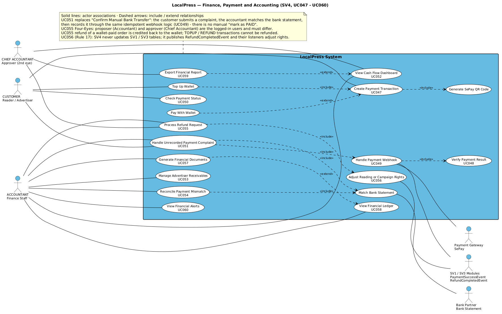
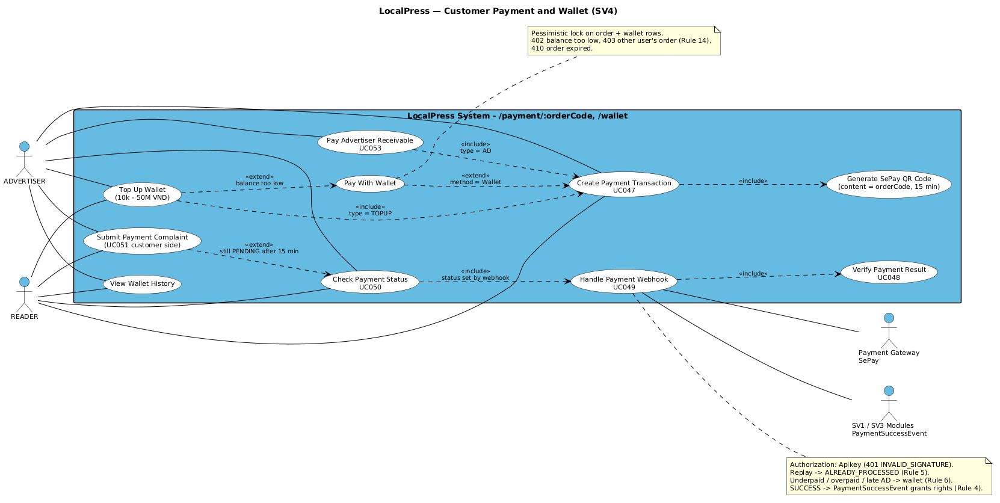
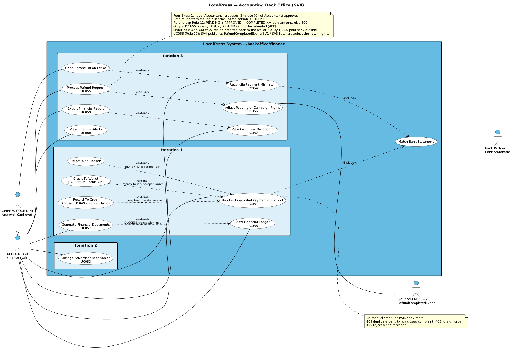

# SƠ ĐỒ USE CASE SV4 — Kế toán, Thanh toán & Đối soát

> **Bản tiếng Việt:** `diagrams_vi/usecase_sv4_vi.png`, `usecase_sv4_customer_vi.png`, `usecase_sv4_backoffice_vi.png`.

> Form theo mẫu `notebooklm_docs/usecase_sv4_standard.png`: khung hệ thống xanh, use case nền trắng ghi "Tên + mã UC", người dùng bên trái, hệ thống ngoài bên phải; nét liền = actor sử dụng, nét đứt = include / extend.
> Nguồn: `docs/sv4/02_source/usecase_sv4*.puml`.

## 1. Sơ đồ chính (đủ 14 UC)

### Actor

| Actor | Vai trò |
|---|---|
| CUSTOMER (Reader / Advertiser) | Tạo đơn, nạp ví, trả bằng ví hoặc QR, xem trạng thái, gửi khiếu nại |
| ACCOUNTANT (Finance Staff) | Xử lý khiếu nại, sổ quỹ, chứng từ, công nợ, đối soát, đề xuất hoàn (mắt 1), dashboard, cảnh báo |
| CHIEF ACCOUNTANT (Approver) | Duyệt hoàn (mắt 2), dashboard, xuất báo cáo |
| Payment Gateway (SePay) | Bắn webhook IPN |
| Bank Partner (Bank Statement) | Sao kê để đối chiếu |
| SV1 / SV3 Modules | Nhận `PaymentSuccessEvent` để cấp quyền; nhận `RefundCompletedEvent` để tự thu hồi quyền khi hoàn tiền (Rule 17) |

### 14 Use Case

| UC | Tên | Iter | Màn hình | Ghi chú |
|---|---|---|---|---|
| UC047 | Create Payment Transaction | 2 | II.4.3 `/payment/:orderCode` | include Generate SePay QR Code; Pay With Wallet là extend |
| UC048 | Verify Payment Result | 2 | (backend) | Được UC049 include: tìm đơn, so số tiền |
| UC049 | Handle Payment Webhook | 2 | (backend) | API key, idempotent, tiền thừa/thiếu/muộn vào ví |
| UC050 | Check Payment Status | 2 | II.4.3 | Polling 3 giây/lần |
| UC051 | **Handle Unrecorded Payment Complaint** | 1 | II.4.2 `/backoffice/finance/complaints`, `/wallet/complaints` | Thay "Confirm Manual Bank Transfer"; include Match Bank Statement và UC049 |
| UC052 | View Cash Flow Dashboard | 3 | II.4.5 | UC059 extend; doanh thu thực thu = gộp - đã hoàn (khớp sổ quỹ) |
| UC053 | Manage Advertiser Receivables | 2 | II.4.4 | Nhóm nợ PAID_IN_FULL / IN_TERM / OVERDUE; mới có API, chưa có màn hình, chưa có nhắc nợ |
| UC054 | Reconcile Payment Mismatch | 3 | II.4.6 | include Match Bank Statement |
| UC055 | Process Refund Request | 3 | II.4.7 | 4 mắt, include UC056; đơn trả bằng ví thì hoàn lại vào ví; không hoàn TOPUP / REFUND |
| UC056 | Adjust Reading or Campaign Rights | 3 | II.4.7 | SV4 phát `RefundCompletedEvent` (có cờ `fullRefund`); listener của SV1/SV3 tự điều chỉnh quyền: hoàn toàn bộ thì thu hồi, hoàn một phần thì giữ quyền. Listener chưa có trong code |
| UC057 | Generate Financial Documents | 1 | II.4.1 | extend UC058, chỉ giao dịch SUCCESS |
| UC058 | View Financial Ledger | 1 | II.4.1 | |
| UC059 | Export Financial Report | 3 | II.4.8 | Mới có API, chưa lọc theo ngày |
| UC060 | View Financial Alerts | 3 | II.4.8 | `REFUND_PENDING`, `COMPLAINT_OPEN`, `DEBT_OVERDUE`; mới có API |

Use case phụ (không có mã, phục vụ giải thích): Generate SePay QR Code, Pay With Wallet, Top Up Wallet, Match Bank Statement.

## 2. Sơ đồ tách theo phía (dùng khi trình bày cho dễ nhìn)

**Phía khách hàng**

- Top Up Wallet thực chất tạo một đơn `TOPUP` (include UC047), và mở ra khi ví không đủ tiền (extend Pay With Wallet).
- Submit Payment Complaint là extend của UC050 khi sau 15 phút đơn vẫn PENDING.
- UC053 phía doanh nghiệp: trả công nợ booking, cũng đi qua UC047 với loại `AD`.

**Phía kế toán (chia theo Iteration)**

- UC051 có 3 kết quả (extend): Record To Order (chạy lại logic UC049), Credit To Wallet, Reject With Reason.
- Chief Accountant kế thừa (mũi tên tam giác) quyền của Accountant, cộng thêm duyệt mắt 2 và chốt kỳ đối soát.
