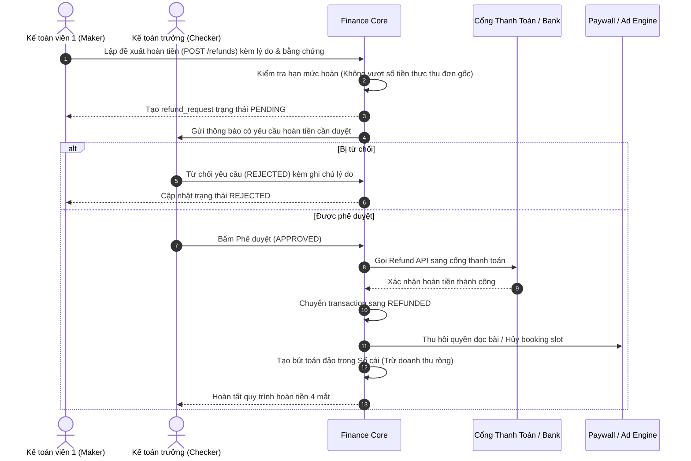

# ĐẶC TẢ CHUYÊN SÂU LUỒNG 4: KẾ TOÁN, THANH TOÁN & ĐỐI SOÁT (FINANCE & RECONCILIATION)
> **Chủ sở hữu luồng:** Sinh viên 4 — Huy (Leader)  
> **Dự án:** LocalPress — Revenue & Trust Platform (FALL 2026 — Đại học FPT)  
> **Phân hệ phụ trách:** `finance`, `transactions`, `refund_requests`, kế toán dòng tiền và đối soát  
> **Tài liệu chuẩn bị cho:** NotebookLM Nghiên cứu Chuyên sâu & Hỏi đáp Luồng 4

---

## 1. TỔNG QUAN LUỒNG NGHIỆP VỤ 4

### 1.1. Sứ mệnh và Mục tiêu tối thượng của Luồng 4
Trong mô hình Doanh thu kép của LocalPress, **Luồng 4 là trái tim tài chính và trục xương sống giao dịch của toàn bộ hệ thống**. Mọi dòng tiền đi vào từ độc giả mua báo (B2C) hay doanh nghiệp đặt quảng cáo (B2B), cũng như mọi dòng tiền đi ra (hoàn tiền, chiết khấu, phí cổng) đều phải đi qua và được quản lý tập trung bởi Luồng 4.

* **Mục tiêu 1 — Toàn vẹn dòng tiền (Financial Integrity):** Đảm bảo mọi giao dịch đều có mã tham chiếu duy nhất, truy xuất được nguồn gốc (mua bài, mua gói hay mua quảng cáo), không thất thoát một đồng doanh thu nào.
* **Mục tiêu 2 — An toàn kỹ thuật & Chống xử lý trùng (Idempotency & Resilience):** Xử lý Webhook IPN từ các cổng thanh toán (VietQR, MoMo, VNPay) có xác thực chữ ký số HMAC SHA512, chống xử lý cộng tiền hai lần; có cơ chế worker chạy ngầm tự động bù quyền khi mạng bị lag.
* **Mục tiêu 3 — Nguyên tắc 4 mắt trong hoàn tiền (Four-Eyes Principle):** Tách biệt người lập đề xuất hoàn tiền với người phê duyệt, thu hồi quyền truy cập tương ứng và tự động trừ giảm doanh thu trên báo cáo.
* **Mục tiêu 4 — Minh bạch đối soát (Reconciliation):** Đối soát tự động giữa sổ cái hệ thống với sao kê ngân hàng/cổng thanh toán, phát hiện và xử lý các giao dịch lệch tiền, sai cú pháp chuyển khoản.
* **Mục tiêu 5 — Chuẩn mực sổ quỹ kép (General Ledger System):** Ghi nhận bút toán Nợ/Có, xử lý sai sót bằng bút toán đảo bổ sung (reversal entries) mà không bao giờ sửa đè hoặc xóa mất lịch sử giao dịch.

### 1.2. Các tác nhân tham gia Luồng 4 (Actors)
1. **Kế toán viên (Finance Staff):**
   * Theo dõi danh sách giao dịch toàn hệ thống (`transactions`).
   * Xác nhận các đơn chuyển khoản ngân hàng thủ công (`UC051`).
   * Quản lý công nợ doanh nghiệp quảng cáo B2B (`UC053`).
   * Nhập sao kê ngân hàng và vận hành màn hình đối soát lệch (`UC054`).
   * Tiếp nhận khiếu nại và lập phiếu đề xuất hoàn tiền (`UC055`).
   * Xuất hóa đơn VAT và chứng từ điện tử (`UC057`).
2. **Kế toán trưởng / Leader (Chief Accountant / Finance Approver):**
   * Phê duyệt các phiếu hoàn tiền theo nguyên tắc 4 mắt (`UC055`).
   * Chốt sổ kỳ đối soát tài chính theo tháng (`UC058`).
   * Cấu hình tỷ lệ thuế VAT và phí cổng giao dịch.
   * Xem và phê duyệt các báo cáo tài chính quản trị xuất file (`UC059`).
3. **Cổng thanh toán & Ngân hàng đối tác (External Gateways):**
   * Cổng VietQR / SePay / VNPay / MoMo gửi Webhook IPN thông báo trạng thái thanh toán.
   * File sao kê tài khoản ngân hàng định kỳ (Excel/CSV).
4. **Các bên liên quan nội bộ (Internal Stakeholders):**
   * **SV1 (Doanh nghiệp):** Gửi yêu cầu thanh toán hợp đồng/chiến dịch quảng cáo sang cổng SV4.
   * **SV3 (Độc giả):** Gửi yêu cầu thanh toán mua bài lẻ / mua gói subscription sang cổng SV4.

---

## 2. TOÀN DIỆN 25 TIÊU CHÍ NGHIỆP VỤ LUỒNG 4 (THE 25 CRITERIA)
*(Được trích xuất nguyên bản và cụ thể hóa từ tài liệu đặc tả gốc `LocalPress_Danh_muc_chuc_nang.docx` — Nhóm gồm 12 P0, 12 P1, 1 P2)*

### Nhóm P0 — Tiêu chí Cốt lõi (Bắt buộc để hệ thống vận hành xuyên suốt):
1. **[P0] SV4_01: Bảng kê dòng tiền toàn hệ thống.**  
   Tổng hợp dòng tiền thu từ quảng cáo (B2B), thu từ Premium (B2C), tiền hoàn và phí dịch vụ cổng. Tách biệt rõ ràng giữa số tiền thực nhận (Net Cash) với tổng giá trị hợp đồng ký kết và doanh thu phân bổ.
2. **[P0] SV4_02: Xác nhận chuyển khoản thủ công.**  
   Cho phép kế toán đối chiếu giao dịch ngân hàng hoặc dữ liệu sao kê giả lập với mã đơn, số tiền và nội dung chuyển khoản. Ảnh chụp ủy nhiệm chi/biên lai của khách chỉ là tài liệu tham khảo hỗ trợ, hệ thống chỉ duyệt khi khớp tiền thực tế trong tài khoản.
3. **[P0] SV4_04: Xuất/in hóa đơn và chứng từ giả lập.**  
   Tự động sinh file PDF/HTML từ thông tin đơn hàng đã chốt thanh toán; có số chứng từ, mã tra cứu, danh mục mặt hàng, thuế VAT và nhãn giả lập chuẩn mực. Phân biệt rõ hóa đơn thương mại với biên nhận thu tiền.
4. **[P0] SV4_05: Xử lý hoàn tiền (Refund Management).**  
   Quy trình tiếp nhận, kiểm tra tính hợp lệ, phê duyệt, gọi API hoàn tiền sang cổng thanh toán và theo dõi kết quả. Chỉ đánh dấu `REFUNDED` khi cổng đã xác nhận; hỗ trợ trạng thái thất bại hoặc chờ cổng xử lý.
5. **[P0] SV4_08: Nhật ký biến động dòng tiền (General Ledger).**  
   Ghi nhận chi tiết từng khoản thu, trích phí cổng, tiền hoàn hoặc điều chỉnh; lưu mã tham chiếu và số dư tính toán sau giao dịch. Đây là sổ theo dõi tài chính kép của hệ thống.
6. **[P0] SV4_11: Bộ xử lý thanh toán dùng chung (Shared Payment Core).**  
   Cung cấp API dùng chung (`POST /api/v1/finance/orders`) cho cả module Quảng cáo (SV1) và Mua báo (SV3) gọi để tạo phiên giao dịch, sinh mã QR, tra cứu trạng thái và hoàn tiền. Nền tảng dùng chung nhưng phân biệt rõ loại đơn hàng qua trường `order_type`.
7. **[P0] SV4_12: Xử lý webhook có xác thực và chống trùng (Idempotent Webhook).**  
   Xác thực nguồn gốc và chữ ký bảo mật HMAC SHA512; kiểm tra mã giao dịch, số tiền, loại tiền tệ và trạng thái. Đảm bảo nếu cổng thanh toán bắn lại cùng một sự kiện nhiều lần thì hệ thống chỉ ghi nhận và cộng tiền đúng 1 lần duy nhất (`ALREADY_PROCESSED`).
8. **[P0] SV4_13: Màn hình đối soát giao dịch lệch (Discrepancy Resolver).**  
   Phát hiện và hiển thị các trường hợp: cổng báo thành công nhưng đơn trong hệ thống chưa cập nhật, khách chuyển sai số tiền, tiền về nhưng cú pháp nội dung sai không khớp mã đơn, hoặc tiền đã trừ nhưng quyền đọc chưa được cấp.
9. **[P0] SV4_17: Áp dụng chính sách hoàn tiền lên quyền lợi.**  
   Khi hoàn tiền, hệ thống tự động thu hồi quyền đọc bài Premium (thu hồi token mua bài lẻ hoặc hạ cấp subscription), hoặc dừng phân phối banner quảng cáo tương ứng; ghi nhận thời điểm hiệu lực thu hồi.
10. **[P0] SV4_20: Phân quyền và phê duyệt tài chính (Nguyên tắc 4 mắt - Four-Eyes Principle).**  
    Tách biệt người lập đề xuất hoàn tiền (Kế toán viên 1) với người phê duyệt (Kế toán trưởng / Leader). Ghi nhận nhật ký danh tính người thực hiện và lý do duyệt/từ chối.
11. **[P0] SV4_21: Điều chỉnh bằng bút toán bổ sung (Reversal Entries).**  
    Khi phát hiện ghi nhận sai sót, hệ thống tạo bản ghi đảo/điều chỉnh có liên kết tham chiếu tới giao dịch gốc; tuyệt đối không cập nhật đè làm mất lịch sử giao dịch ban đầu.
12. **[P0] SV4_23: Cảnh báo giao dịch cần xử lý.**  
    Hiển thị cảnh báo trực quan cho kế toán về các khoản thanh toán chờ quá lâu (quá 30 phút), lỗi webhook không giải mã được chữ ký, yêu cầu hoàn tiền bị treo, hoặc sự cố nghẽn mạng khi cấp quyền đọc.

### Nhóm P1 — Tiêu chí Nâng cấp (Tăng tính thực tiễn và chuyên nghiệp cho tòa soạn):
13. **[P1] SV4_03: Báo cáo công nợ doanh nghiệp (Accounts Receivable).**  
    Xem các khoản chưa thu của doanh nghiệp quảng cáo B2B, ngày đến hạn, số ngày quá hạn, phân loại theo nhóm tuổi nợ (dưới 30 ngày, 30-60 ngày, quá 60 ngày); mở trực tiếp hợp đồng và các đợt thanh toán liên quan.
14. **[P1] SV4_06: Cấu hình thuế VAT và phí cổng thanh toán.**  
    Lưu trữ tỷ lệ phần trăm thuế VAT (vd: 8%, 10%) và phí chiết khấu của cổng thanh toán (vd: VietQR 0%, VNPay 1.5% + 1.100 ₫). Đơn hàng cũ giữ nguyên bản chụp cấu hình tại thời điểm giao dịch, không bị tính lại khi cấu hình mới thay đổi.
15. **[P1] SV4_07: Báo cáo doanh thu theo chuyên mục.**  
    Doanh thu mua bài lẻ gắn trực tiếp với bài viết và chuyên mục đó; đối với các gói thuê bao đọc nhiều chuyên mục, áp dụng quy tắc phân bổ quản trị minh bạch (phân bổ theo lượt đọc thực tế trong kỳ).
16. **[P1] SV4_09: Chốt kỳ đối soát tháng.**  
    Chức năng khóa sổ tài chính cuối tháng: tổng hợp sai lệch chưa xử lý, lưu vết người chốt và thời điểm chốt; đóng băng dữ liệu để không thể sửa đổi các chứng từ trong kỳ đã khóa.
17. **[P1] SV4_14: Quản lý đặt cọc và trả nhiều đợt.**  
    Hỗ trợ hợp đồng quảng cáo thanh toán nhiều đợt (đặt cọc 50%, thanh toán 50% còn lại); ghi nhận từng đợt vào đúng nghĩa vụ của hợp đồng và xác định đợt nào đủ điều kiện kích hoạt chiến dịch.
18. **[P1] SV4_15: Nhắc công nợ và theo dõi thu hồi.**  
    Thiết lập lịch nhắc nợ tự động gửi email cho doanh nghiệp trước hạn 3 ngày và khi quá hạn; lưu lại phản hồi cam kết trả tiền; dừng chiến dịch nếu nợ quá hạn theo quy định.
19. **[P1] SV4_16: Dashboard thuê bao định kỳ (MRR / ARR / Churn Rate).**  
    Thống kê số lượng thuê bao hoạt động, gia hạn mới, tỷ lệ hủy (Churn Rate), tính toán doanh thu định kỳ theo tháng (MRR) và quy đổi năm (ARR) theo chuẩn mực quốc tế. Loại trừ doanh thu mua lẻ và quảng cáo khỏi MRR.
20. **[P1] SV4_18: Phân biệt thu tiền với doanh thu theo kỳ (Accrual vs Cash).**  
    Theo dõi các khoản thu trước (Unearned Revenue) cho các hợp đồng quảng cáo dài hạn hoặc gói độc giả 1 năm; phân bổ doanh thu đều theo từng tháng phục vụ báo cáo quản trị.
21. **[P1] SV4_19: Theo dõi chi phí khuyến mãi & Chiết khấu.**  
    Thống kê số tiền giảm giá theo voucher, chiến dịch khuyến mãi hoặc chiết khấu thương mại VIP; đảm bảo khi tính hoàn tiền không hoàn lại phần tiền đã được chiết khấu.
22. **[P1] SV4_22: Xuất báo cáo kế toán quản trị (Export PDF/Excel).**  
    Xuất báo cáo chi tiết theo kỳ, theo nguồn thu B2B/B2C, theo doanh nghiệp hoặc gói cước; có mộc thời gian chốt số liệu và bộ lọc tiêu chí.
23. **[P1] SV4_24: Đối chiếu tiền gateway chuyển về (Settlement Payouts).**  
    So sánh giữa tổng tiền khách đã thanh toán, trừ phí giao dịch cổng, trừ tiền đã hoàn với số tiền thực tế cổng thanh toán chuyển khoản về tài khoản ngân hàng của tòa soạn.
24. **[P1] SV4_25: Hồ sơ xử lý tranh chấp thanh toán (Chargeback Cases).**  
    Tập hợp hồ sơ khiếu nại của khách hàng gồm: thông tin đơn, log xác minh hệ thống, sao kê ngân hàng và lịch sử trao đổi; ghi nhận người thụ lý, kết luận và quyết định xử lý.

### Nhóm P2 — Tiêu chí Mở rộng:
25. **[P2] SV4_10: AI Fraud Analytics — Phát hiện thanh toán bất thường.**  
    Sử dụng mô hình AI phân tích dữ liệu giao dịch: phát hiện tần suất thử thẻ/tạo đơn bất thường (quá 5 lần/phút từ cùng một IP), đơn hàng có số tiền chênh lệch so với giá niêm yết, hoặc IP đến từ vị trí đáng ngờ. AI đưa ra cảnh báo và giải thích lý do; tuyệt đối không tự ý chặn đơn hay tự ý hoàn tiền mà để kế toán viên đưa ra quyết định.

---

## 3. CHI TIẾT 14 USE CASES CỦA LUỒNG 4 (`UC047` - `UC060`)

14 Use Cases của SV4 được theo dõi chính thức trong `project_tracking_group2.xlsx`:

| UC ID | Tên Use Case | Tác nhân chính (Actors) | Mục tiêu nghiệp vụ | Trạng thái & Iteration |
| :--- | :--- | :--- | :--- | :---: |
| **UC047** | Create Payment Transaction | Reader, Advertiser, Gateway | Khởi tạo đơn thanh toán dùng chung cho Mua bài, Mua gói hoặc Booking quảng cáo; sinh mã VietQR. | Iter 2 |
| **UC048** | Verify Payment Result | Payment Gateway, Staff | Kiểm tra và xác minh tính toàn vẹn của kết quả thanh toán (mã tham chiếu, số tiền, đơn vị tiền tệ). | Iter 2 |
| **UC049** | Handle Payment Webhook | Payment Gateway | Tiếp nhận Webhook IPN từ cổng thanh toán, kiểm tra chữ ký HMAC SHA512, xử lý idempotent chống trùng. | Iter 2 |
| **UC050** | Check Payment Status | Reader, Advertiser, Gateway | Tra cứu trạng thái thanh toán mới nhất của đơn hàng qua API hoặc polling. | Iter 2 |
| **UC051** | Confirm Manual Bank Transfer | Staff | Kế toán đối chiếu sao kê ngân hàng và xác nhận duyệt đơn chuyển khoản thủ công. | Iter 1 |
| **UC052** | View Cash Flow Dashboard | Staff | Xem dashboard tổng thể dòng tiền: thu B2B, thu B2C, phí cổng, tiền hoàn và biểu đồ tăng trưởng. | Iter 3 |
| **UC053** | Manage Advertiser Receivables | Staff, Advertiser | Theo dõi công nợ nhà quảng cáo, hạn thanh toán, đợt đặt cọc và kích hoạt gửi thông báo nhắc nợ. | Iter 2 |
| **UC054** | Reconcile Payment Mismatch | Staff, Payment Gateway | Đối soát và xử lý các giao dịch lệch: lệch tiền, sai mã đơn, thừa/thiếu tiền hoặc lỗi cấp quyền. | Iter 3 |
| **UC055** | Process Refund Request | Staff, Payment Gateway | Tiếp nhận đề xuất hoàn tiền, duyệt theo nguyên tắc 4 mắt, gọi cổng hoàn tiền và theo dõi kết quả. | Iter 3 |
| **UC056** | Adjust Reading or Campaign Rights | Staff | Tự động thu hồi quyền đọc bài Premium hoặc tạm dừng chiến dịch quảng cáo sau khi hoàn tiền. | Iter 3 |
| **UC057** | Generate Financial Documents | Staff | Sinh và phát hành hóa đơn VAT điện tử, biên lai thu tiền có mã chứng từ tra cứu. | Iter 1 |
| **UC058** | View Financial Ledger | Staff | Xem sổ quỹ kép ghi nhận toàn bộ bút toán thu, chi, phí, hoàn và chốt kỳ đối soát tháng. | Iter 1 |
| **UC059** | Export Financial Report | Staff | Xuất các báo cáo tài chính định kỳ (doanh thu, công nợ, đối soát, hoàn tiền) ra file Excel/PDF. | Iter 3 |
| **UC060** | View Financial Alerts | Staff, Notification Gateway | Xem trung tâm cảnh báo tài chính: giao dịch treo, webhook lỗi chữ ký, hoàn tiền chưa xử lý. | Iter 3 |

---

## 4. CHI TIẾT 8 MÀN HÌNH / PHÂN HỆ CHỨC NĂNG CỦA SV4

8 Màn hình được phân bổ theo **3 Đợt triển khai (Activity Flow)** trong `project_tracking_group2.xlsx`:

```
┌─────────────────────────────────────────────────────────────────────────────┐
│                            LỘ TRÌNH 8 MÀN HÌNH SV4                          │
├───────────────────────────────┬───────────────────────────────┬─────────────┤
│   ITERATION 1 (Đầu quy trình) │   ITERATION 2 (Giữa quy trình)│ ITERATION 3 │
├───────────────────────────────┼───────────────────────────────┼─────────────┤
│ 1. Financial Documents &      │ 3. Payment Processing         │ 5. Cash Flow│
│    Ledger (II.4.1)            │    (II.4.3)                   │    Dashboard│
│ 2. Manual Bank Transfer       │ 4. Advertiser Receivables     │ 6. Reconcil.│
│    Confirmation (II.4.2)      │    (II.4.4)                   │ 7. Refund   │
│                               │                               │ 8. Reports  │
└───────────────────────────────┴───────────────────────────────┴─────────────┘
```

### 4.1. Iteration 1 — Đầu quy trình (Master Data & Xử lý cơ bản):
* **Màn hình 1 — Financial Documents and Ledger (SRS/SDS II.4.1 — `UC057, UC058`):**
  * *Mục tiêu:* Sổ cái ghi nhận dòng tiền giao dịch; phát hành và quản lý hóa đơn VAT điện tử, biên nhận thu tiền.
  * *Bảng CRUD:* `transactions: R`, `users: R`, `advertisers: R`.
  * *Tính năng:* Danh sách sổ cái theo thời gian thực; xem chi tiết bút toán; tạo hóa đơn VAT từ đơn hàng đã thanh toán; tải file PDF hóa đơn/chứng từ giả lập.
* **Màn hình 2 — Manual Bank Transfer Confirmation (SRS/SDS II.4.2 — `UC051`):**
  * *Mục tiêu:* Kế toán đối chiếu thông tin chuyển khoản từ ngân hàng và xác nhận duyệt đơn thủ công cho khách không thanh toán qua QR tự động.
  * *Bảng CRUD:* `transactions: RU`, `audit_logs: C`.
  * *Tính năng:* Danh sách đơn chuyển khoản chờ duyệt; hiển thị thông tin đối chiếu (Mã đơn, Số tiền, Tên người chuyển, Ảnh biên lai tham khảo); nút "Xác nhận đã nhận tiền" (chuyển đơn sang `SUCCESS` và kích hoạt cấp quyền) hoặc "Từ chối" kèm lý do.

### 4.2. Iteration 2 — Giữa quy trình (Giao dịch lõi & Cổng thanh toán):
* **Màn hình 3 — Payment Processing (SRS/SDS II.4.3 — `UC047, UC048, UC049, UC050`):**
  * *Mục tiêu:* Bộ xử lý thanh toán trung tâm: Khởi tạo mã VietQR/cổng thanh toán (VNPay/MoMo); tiếp nhận và xử lý Webhook IPN Idempotent, tự động cập nhật giao dịch.
  * *Bảng CRUD:* `transactions: CRU`, `subscriptions: RU`, `article_purchases: RU`, `ad_campaigns: RU`.
  * *Tính năng:* Sinh phiên thanh toán; hiển thị modal VietQR động cho độc giả/doanh nghiệp; lắng nghe Webhook có xác thực chữ ký SHA512; kiểm tra mã đơn và chống cộng trùng tiền.
* **Màn hình 4 — Advertiser Receivables (SRS/SDS II.4.4 — `UC053`):**
  * *Mục tiêu:* Theo dõi và quản lý công nợ khách hàng quảng cáo B2B, quản lý thời hạn tín dụng và kích hoạt gửi thông báo nhắc nợ.
  * *Bảng CRUD:* `advertisers: R`, `ad_campaigns: RU`, `transactions: R`.
  * *Tính năng:* Bảng tổng hợp công nợ theo từng doanh nghiệp; lọc theo nhóm tuổi nợ; theo dõi tiến độ thanh toán từng đợt (đặt cọc/thanh toán dứt điểm); nút gửi email nhắc nợ tự động.

### 4.3. Iteration 3 — Cuối quy trình (Đối soát, Hoàn tiền & Báo cáo nâng cao):
* **Màn hình 5 — Cash Flow Dashboard (SRS/SDS II.4.5 — `UC052`):**
  * *Mục tiêu:* Dashboard dòng tiền trực quan, biểu đồ doanh thu theo ngày/tuần/tháng, phân tích tỷ trọng nguồn thu B2B (quảng cáo) và B2C (bán báo/gói).
  * *Bảng CRUD:* `transactions: R`, `refund_requests: R`.
  * *Tính năng:* Các thẻ chỉ số KPI (Tổng doanh thu, Doanh thu thực nhận, Tiền hoàn, Phí cổng); biểu đồ tăng trưởng doanh thu; biểu đồ tỷ trọng cơ cấu nguồn thu.
* **Màn hình 6 — Payment Reconciliation (SRS/SDS II.4.6 — `UC054`):**
  * *Mục tiêu:* Đối soát dữ liệu giao dịch tự động giữa hệ thống LocalPress với file sao kê đối tác cổng thanh toán hoặc ngân hàng.
  * *Bảng CRUD:* `transactions: RU`, `audit_logs: C`.
  * *Tính năng:* Tải lên file sao kê ngân hàng (Excel/CSV); hệ thống tự động so khớp mã giao dịch và số tiền; danh sách giao dịch lệch (thừa tiền, thiếu tiền, sai nội dung); công cụ xử lý lệch thủ công.
* **Màn hình 7 — Refund and Rights Management (SRS/SDS II.4.7 — `UC055, UC056`):**
  * *Mục tiêu:* Tiếp nhận, kiểm tra và phê duyệt yêu cầu hoàn tiền theo nguyên tắc 4 mắt (gọi Refund API sang cổng thanh toán), tự động điều chỉnh thu hồi quyền đọc bài hoặc vị trí quảng cáo.
  * *Bảng CRUD:* `refund_requests: CRU`, `transactions: RU`, `subscriptions: RU`, `article_purchases: RU`, `ad_campaigns: RU`.
  * *Tính năng:* Danh sách yêu cầu hoàn tiền; form lập đề xuất hoàn (Kế toán viên); màn hình duyệt hoàn tiền (Kế toán trưởng); gọi cổng thanh toán; tự động thu hồi quyền đọc của tài khoản; ghi log kiểm toán.
* **Màn hình 8 — Financial Reports and Alerts (SRS/SDS II.4.8 — `UC059, UC060`):**
  * *Mục tiêu:* Xuất báo cáo tài chính định kỳ (Excel/PDF); trung tâm hiển thị cảnh báo các khoản thanh toán treo, lỗi webhook hoặc thanh toán bất thường từ AI.
  * *Bảng CRUD:* `transactions: R`, `refund_requests: R`, `notifications: CR`.
  * *Tính năng:* Bộ lọc thời gian và loại báo cáo; nút xuất file Excel/PDF chuẩn hóa; danh sách cảnh báo thời gian thực kèm mức độ nghiêm trọng (Cảnh báo đỏ: webhook lỗi, Cảnh báo vàng: thanh toán chờ quá 30 phút).

---

## 5. CÁC CƠ CHẾ KỸ THUẬT & KIẾN TRÚC CỐT LÕI CỦA LUỒNG 4

### 5.1. Bộ xử lý Thanh toán Dùng chung (Shared Payment Core)
Cung cấp REST API nội bộ tập trung cho toàn bộ hệ thống:
* **Endpoint tạo đơn:** `POST /api/v1/finance/orders`
* **Request DTO (`CreatePaymentOrderRequest`):**
  ```json
  {
    "userId": 105,
    "orderType": "SUBSCRIPTION", // hoặc "ARTICLE_PURCHASE", "AD_CAMPAIGN"
    "targetId": 12,              // subscriptionId, purchaseId hoặc campaignId
    "amount": 50000.00,
    "paymentMethod": "VIETQR",   // VIETQR, MOMO, VNPAY, BANK_TRANSFER
    "notes": "Thanh toan goi Premium thang"
  }
  ```
* **Response DTO (`PaymentOrderResponse`):**
  * Trả về `transactionCode` (mã giao dịch hệ thống dạng `TXN-20261007-XXXX`), `qrCodeUrl` (chuỗi hình ảnh VietQR chuẩn Napas 247 kèm đúng số tiền và cú pháp chuyển khoản), hạn chót thanh toán (`expiresAt`).

### 5.2. Thuật toán Webhook IPN Idempotent & Chống cộng tiền hai lần
Khi ngân hàng hoặc cổng thanh toán gửi thông báo Webhook IPN (`POST /api/v1/finance/webhook/{gateway}`):
```
                  ┌───────────────────────────────┐
                  │    Webhook IPN từ Gateway     │
                  └───────────────┬───────────────┘
                                  │
                                  ▼
                     [1. Kiểm tra chữ ký số]
                     (HMAC SHA512 với bí mật)
                                  │
                    ┌─────────────┴─────────────┐
                    │ Hợp lệ                    │ Sai chữ ký
                    ▼                           ▼
          [2. Tra cứu giao dịch]       [Trả về 400 Bad Request]
          (Theo transactionCode)       (Ghi log cảnh báo an ninh)
                    │
                    ▼
          [3. Kiểm tra trạng thái]
                    │
        ┌───────────┴───────────┐
        │ PENDING               │ SUCCESS hoặc REFUNDED
        ▼                       ▼
 [4. Đổi sang SUCCESS]    [Trả về 200 OK với thông điệp:]
 [Kích hoạt cấp quyền]    ["ALREADY_PROCESSED - Idempotent"]
 [Ghi Sổ cái dòng tiền]   (Tuyệt đối không cấp quyền 2 lần)
```

### 5.3. Cơ chế Khắc phục Nghẽn mạng (Entitlement Retry Worker)
Nếu Webhook đã trừ tiền thành công của khách hàng nhưng hệ thống bị lỗi mạng đột ngột (network timeout) khiến việc gọi module bài viết/quảng cáo bị gián đoạn:
* Giao dịch được lưu với trạng thái `SUCCESS` nhưng cờ `entitlement_status = PENDING_RETRY`.
* Một Scheduled Task ngầm (`EntitlementRetryJob`) chạy định kỳ mỗi 2 phút:
  * Quét các giao dịch thành công nhưng chưa cấp quyền.
  * Thử gọi kích hoạt lại quyền đọc bài hoặc slot quảng cáo.
  * Tự động gửi thông báo cho khách hàng khi hoàn tất.
  * Khách hàng **không bao giờ bị yêu cầu chuyển tiền lần 2**.

### 5.4. Quy trình Hoàn tiền theo Nguyên tắc 4 Mắt (Four-Eyes Refund Workflow)
Nguyên tắc 4 mắt (Maker-Checker Principle) đảm bảo tính minh bạch, chống gian lận thông đồng rút ruột ngân sách:



### 5.5. Sổ Quỹ Kép (General Ledger) & Bút toán Đảo Bổ sung
* **Không ghi đè (Append-only Ledger):** Bảng ghi nhận tài chính không bao giờ thực hiện câu lệnh `UPDATE` hay `DELETE` trên số tiền gốc đã ghi nhận.
* **Bút toán đảo (Reversal Entry):** Khi hoàn tiền hoặc điều chỉnh sai sót kế toán, hệ thống chèn một bản ghi mới có giá trị âm hoặc bút toán đối ứng, liên kết tới `original_transaction_id`.
* **Khóa kỳ kế toán (Month-end Closing):** Khi Kế toán trưởng bấm "Chốt sổ tháng", trạng thái kỳ kế toán chuyển sang `CLOSED`. Bất kỳ yêu cầu chỉnh sửa chứng từ nào trong tháng đó đều bị hệ thống chặn lại ở tầng cơ sở dữ liệu.

### 5.6. Định nghĩa Chuẩn mực các Chỉ số Tài chính
| Chỉ số | Tên đầy đủ | Công thức tính chuẩn | Lưu ý nghiệp vụ |
| :--- | :--- | :--- | :--- |
| **Net Revenue** | Doanh thu ròng | $\text{Doanh thu gộp} - \text{Phí cổng thanh toán} - \text{Tiền hoàn}$ | Phản ánh dòng tiền thực tế tòa soạn được hưởng. |
| **MRR** | Monthly Recurring Revenue | $\sum (\text{Giá trị gói thuê bao quy đổi 1 tháng})$ | Gói 1 năm chia cho 12 tháng. **Không tính** mua bài lẻ hay quảng cáo B2B. |
| **ARR** | Annual Run Rate | $\text{MRR} \times 12$ | Doanh thu định kỳ ước tính cả năm từ độc giả trả phí. |
| **Churn Rate** | Tỷ lệ rời bỏ độc giả | $\frac{\text{Số thuê bao hủy trong tháng}}{\text{Số thuê bao hoạt động đầu tháng}} \times 100\%$ | Đo lường độ hài lòng của người đọc đối với chất lượng bài viết. |
